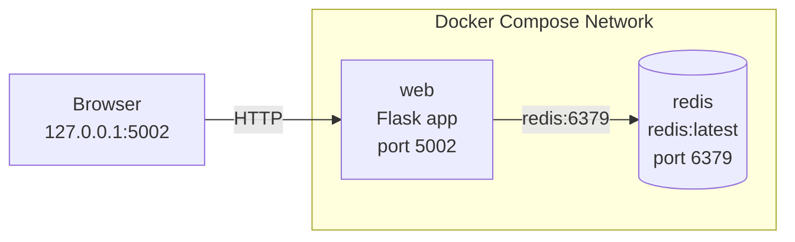
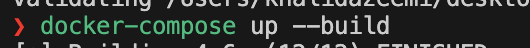
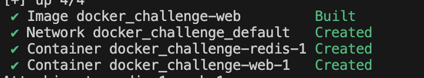
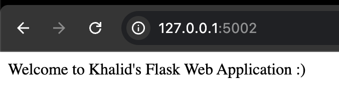
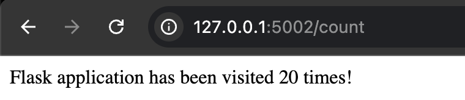
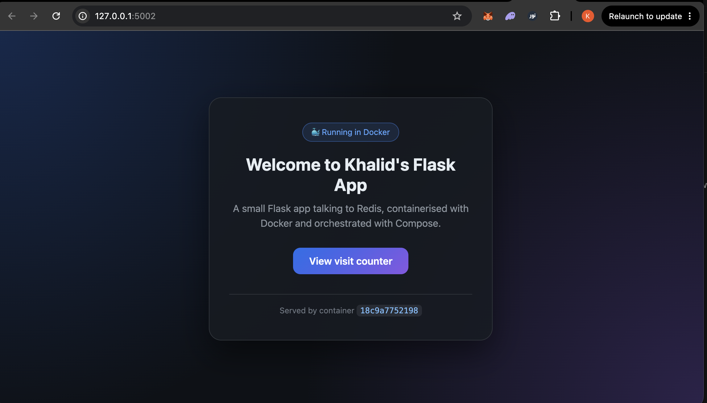
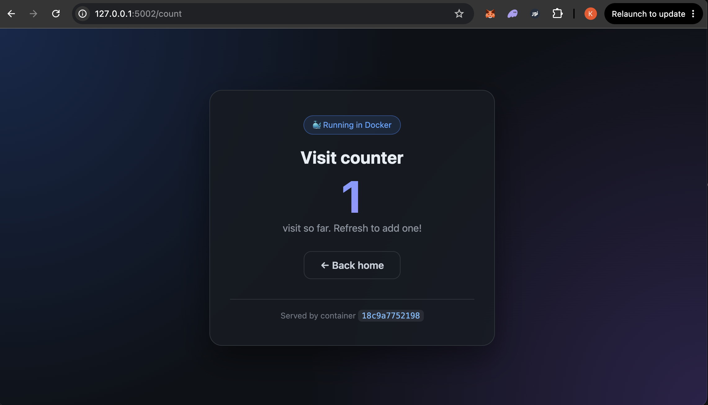
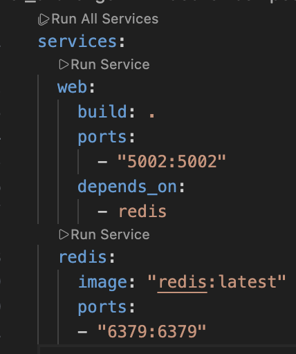
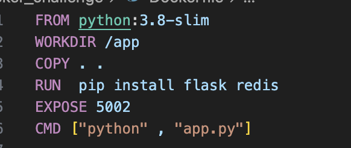
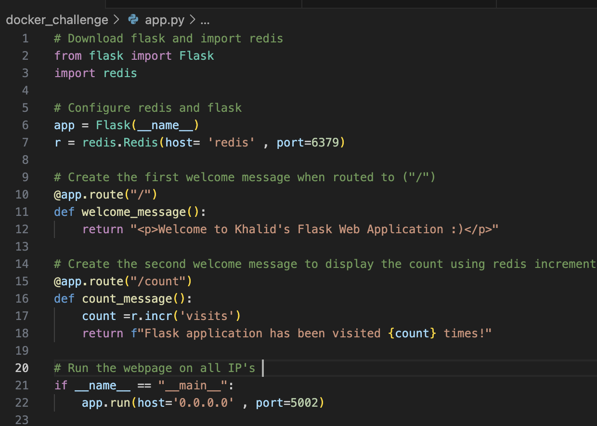

# Dockerised Flask + Redis Visit Counter

A small multi-container web application built with Flask and Redis, containerised with Docker and orchestrated with Docker Compose. Every visit to the `/count` page increments a counter stored in Redis, so the count survives page refreshes and Flask restarts as long as the Redis container is running.

---

## Tech Stack

| Tool | Purpose |
|------|---------|
| **Python 3.8** (`python:3.8-slim`) | Application runtime |
| **Flask** | Web framework serving the routes |
| **Redis** (`redis:latest`) | In-memory data store for the visit counter |
| **Docker** | Containerises the Flask app |
| **Docker Compose** | Defines and runs the multi-container setup |

---

## What the App Does

The Flask app exposes two routes:

| Route | Description |
|-------|-------------|
| `/` | Returns a welcome message |
| `/count` | Increments a `visits` key in Redis (`INCR`) and displays how many times the page has been visited |

The Flask container connects to Redis using the Compose service name (`redis`) as the hostname, on port `6379`. The app listens on `0.0.0.0:5002` so it is reachable from outside the container.

### Architecture



### Project Structure

```
docker_challenge/
├── app.py               # Flask application
├── Dockerfile           # Builds the web image
├── docker-compose.yml   # Defines the web + redis services
└── images/              # Screenshots used in this README
```

---

## How to Run It

### Prerequisites

- [Docker](https://docs.docker.com/get-docker/) and Docker Compose installed

### Steps

1. **Clone the repository**

   ```bash
   git clone <your-repo-url>
   cd docker_challenge
   ```

2. **Build and start the containers**

   ```bash
   docker-compose up --build
   ```

3. **Open the app in your browser**

   - Welcome page: <http://127.0.0.1:5002>
   - Visit counter: <http://127.0.0.1:5002/count>

4. **Stop the containers**

   ```bash
   docker-compose down
   ```

---

## Screenshots

### Building and starting the stack


### Containers running


### Home route (`/`)


### Visit counter route (`/count`)


### Updated web page: home (`/`)


### Updated web page: visit counter (`/count`)


### Configuration files

**`docker-compose.yml`**



**`Dockerfile`**



**`app.py`**


